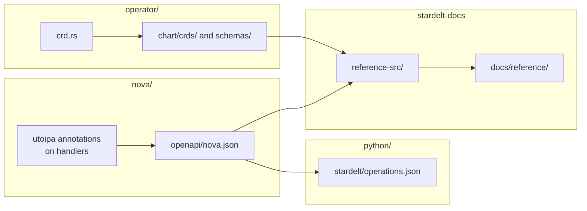

# Contributing to stardelt

How a change is made in this repository: where it goes, what is generated, what holds everywhere,
and the recipes for the common ones. Paths are from this repository's root; `stardelt-docs/` is the
sibling checkout of the documentation site.

The process — branches, commits, review, AI-assisted work — is on
[the contributing page](https://stardelt.io/docs/developer). Agent-facing rules are in
[`AGENTS.md`](AGENTS.md) and the `AGENTS.md` in each folder.

Where things live and how they get generated. For what the platform does, read
[How it works](https://stardelt.io/docs/architecture/how-it-works) first.

## Where a change goes

| You want to change | Folder | Start at |
|---|---|---|
| An API route | `nova/` | `backend/src/main.rs` (`api_router`, `admin_router`) |
| A screen | `nova/` | `frontend/src/App.tsx` (routes), `frontend/src/components/Shell.tsx` (navigation) |
| A resource (`Pipeline`, `Catalog`, …) | `operator/` | `crates/stardelt-operator/src/crd.rs` |
| What the operator does with a resource | `operator/` | `controller.rs`, `planner.rs` |
| How a service is configured | `platform/` and `operator/` | `helm-values/`, `manifests/`, `chart/`; `crates/stardelt-operator/values/` |
| The install order | `platform/` | `Makefile` (`step-*`), `scripts/platform.sh` |
| The Python package, command line or MCP tools | `python/` | `stardelt/` |
| How pipelines run in Airflow | `demos/` | `dags/pipeline_loader.py`, `dags/stardelt_pipelines/` |

## What is generated

Never edit generated files by hand. Change the source and regenerate, or CI fails.



| File | Comes from | Regenerate with |
|---|---|---|
| `nova/openapi/nova.json` | Handler annotations | `UPDATE_OPENAPI=1 cargo test -p stardelt-nova-backend openapi` |
| `operator/chart/crds/`, `schemas/` | `crd.rs` | `cargo run --bin crdgen` |
| `python/stardelt/operations.json` | Nova's contract on `main` | `python scripts/sync_contract.py` |
| `stardelt-docs/reference-src/`, `docs/reference/` | Both of the above, on `main` | `npm run sync:reference && npm run gen:reference` |

## Three ways to install, one set of versions

The platform can be installed three ways, and each has its own copy of the configuration:

| Path | Lives in | Who it is for |
|---|---|---|
| `make platform`, `make install` | `platform/Makefile`, `helm-values/`, `manifests/`, `scripts/` | The complete platform today |
| Umbrella chart | `platform/chart/` | One Helm release; the core, sign-in and the applications |
| Operator | `crates/stardelt-operator/src/planner.rs`, `values/` | The direction of travel ([milestone v0.2](https://stardelt.io/docs/roadmap)) |

So a change to how a service runs usually touches more than one place. CI compares the versions
(`scripts/check-version-parity.sh`, `scripts/check-platform-pins.sh`), but it cannot compare behaviour.
Some scripts are copied into the operator, such as `access_sync_job.py`. A copy is a dependency: when you
change the original, change the copy.

## Rules that hold everywhere

- **Group membership is the role.** There are no per-user special cases.
- **No committed credentials and no fixed defaults.** Generate secrets at install, once. CI checks with
  `scripts/check-no-default-secrets.sh`.
- **A token never appears in a URL, a log line or an error message.**
- **Whatever the interface can do, the API can do.** A route is tagged `public` (stable; tools may
  rely on it) or `internal` (for the interface only; it may change). A breaking change to a `public`
  route bumps Nova's version.
- **Your tables stay open.** Nothing writes a private table format or a side channel past the catalog.
- **Upstream stays upstream.** No forks: fixes go to the upstream project. Keep values and glue small.
- **Pin everything.** Chart versions in the `Makefile`, images by digest.
- **Every volume has a backup or a stated reason not to.** `make verify-backups-all` fails on a new
  volume until it does.
- **Licenses:** see the [policy](https://stardelt.io/docs/architecture/licenses). It covers your dependencies too.
- **`NOVA_AUTH_MODE=dev` keeps working.** CI and demo mode depend on it.
- **A page says what is true now.** See [Document a feature](#document-a-feature).

## Recipes

The steps for common changes. Each one touches several repositories, and missing a step usually
shows up later somewhere else. Make one pull request per repository, in the order given.

### Change the API

1. **Nova.** Write the handler and add its route in `api_router()` in `backend/src/main.rs`. Use
   `admin_router()` for administrator routes.
2. Annotate it with `#[utoipa::path]`, tag it `public` or `internal`, derive `ToSchema` on its types, and
   register it in `backend/src/openapi.rs`.
3. Serve it in demo mode too (`backend/src/demo.rs`) if the interface uses it.
4. Regenerate and commit the contract:

   ```bash
   UPDATE_OPENAPI=1 cargo test -p stardelt-nova-backend openapi
   ```

5. A breaking change to a `public` route also bumps the version in Nova's backend crate.
6. **Python**, after the Nova change is on `main`, for `public` routes: run
   `python scripts/sync_contract.py` and commit `stardelt/operations.json`.
7. **Docs**, after the Nova change is on `main`: run
   `npm run sync:reference && npm run gen:reference`, and update the guide that describes the behaviour.

### Change a resource

1. **Operator.** Change the type in `crates/stardelt-operator/src/crd.rs`, with a doc comment on every
   field: it becomes the [reference](https://stardelt.io/docs/reference/resources). Add a default so existing resources stay
   valid, and tests next to the type.
2. Change the controller or planner that uses it.
3. Regenerate and commit:

   ```bash
   cargo run --bin crdgen     # writes chart/crds/ and schemas/
   ```

4. **Demos**, if you changed `Pipeline` validation: keep `dags/stardelt_pipelines/plan.py` in step with
   `PipelineSpec::validate`.
5. **Docs**, after the change is on `main`: run `npm run sync:reference && npm run gen:reference`.
6. **On a running cluster:** the operator applies the regenerated schema at its next start,
   so roll it (`./scripts/pin-image.sh stardelt-operator`). For a cluster whose operator
   predates that, `kubectl apply --server-side -f chart/crds/` still works.

### Add a screen

1. **Nova.** Add the route in `frontend/src/routes/`, register it in `frontend/src/App.tsx`, and add the
   navigation entry in `frontend/src/components/Shell.tsx`.
2. Back it with an API route ([Change the API](#change-the-api)), so it works from scripts too.
3. Try it with `make demo`, and check it with `npm --prefix frontend run build`.
4. **Docs.** Use the same words as the screen, because readers look for the label they see.

### Add or upgrade a service

**Before you start,** open an issue that names the published interface it sits behind and its license.
It has to pass [these criteria](https://stardelt.io/docs/architecture/services#service-selection-criteria).

**Platform:**

1. Pin the chart in the `Makefile` as `<COMPONENT>_VERSION`.
2. Add `helm-values/<component>.yaml`, with `slim/` overrides if needed for small nodes, and a `step-<component>`
   target. Add a step to `scripts/platform.sh` if it belongs in the default install.
3. Add it to `chart/Chart.yaml` and `chart/values.yaml`, off by default unless it belongs in the core. The
   versions must match: `bash scripts/check-version-parity.sh`.
4. Add a `helm template` step to `.github/workflows/ci.yml`.
5. Generate secrets at install, with `scripts/app-secrets.sh` as the example.
6. Give each new volume a backup, or add an accepted exception: `make verify-backups-all`.

**Operator:**

7. Add the pin to `chart_version` in `planner.rs` and the values to `crates/stardelt-operator/values/`.
   Check with `bash scripts/check-platform-pins.sh`.

**Nova**, if people should see it: add it to the app list in `backend/src/apps.rs`.

**Docs:**

8. Add a row to [Services](https://stardelt.io/docs/architecture/services): what it does, its chart and version, the
   values file and `make` target, and the licence.
9. If it signs users in, add it to [Sign-in](https://stardelt.io/docs/operations/sign-in).

**To upgrade only:** Renovate proposes most pins. Read the upstream license and release notes, and update
any copy that CI's version checks name.

### Fix something on both install paths

1. Fix it in `platform/`, and add a test or check if you can.
2. Look for the same logic in `operator/`. `crates/stardelt-operator/src/` has copies of scripts,
   and `values/` has copies of settings.
3. Fix the copy in a second pull request, with a test in the crate that pins the behaviour.

### Document a feature

Write the page in the pull request that ships the behaviour, or straight after it. Then:

1. **Choose the place.** Getting started for first steps, guides for working with data, operations for running
   it, architecture for how it fits, services for one component. Reference pages are generated.
2. **Lead with what the reader can do,** then the steps, then the limits. Use the labels on the screen.
3. **Check every claim** against `main` and a running install. Show commands you have run.
4. **Say what is true now.** A limit belongs in a short "Not available yet" list. Something not built belongs
   on the [roadmap](https://stardelt.io/docs/roadmap), never in a guide.
5. **Leave these out:** issue numbers, milestones, dates of work, who built it, how a decision was made,
   other products, and any mention of internal notes.
6. **Run `npm run build`.** It fails on broken links.

## Skills for AI assistants

A *skill* is a short instruction file that tells an AI assistant how a kind of work is done here. These
skills are for **building** stardelt. To **use** a stardelt platform from an assistant, see
[Python](https://stardelt.io/docs/guides/python) instead.

They live in [`skills/`](https://github.com/stardelt/stardelt-docs/tree/main/skills), in the
`stardelt-docs` repository. Each is plain Markdown, so any assistant or any person can read it.

| Skill | Use it to |
|---|---|
| `change-api` | Change a Nova API route and carry it through the contract, the Python package and the docs |
| `change-resource` | Change a resource and regenerate everything that depends on it |
| `add-service` | Add or upgrade a service across all install paths |
| `write-docs-page` | Write a page that follows this site's rules |
| `check-docs-facts` | Check a page's claims against the code and a running install |
| `write-issue` | Write an issue that someone with no context can implement |
| `write-skill` | Add a new skill to this list |

### Use them

Check out the repositories side by side, then:

- **Claude Code** finds them from a `stardelt-docs` checkout through `.claude/skills`. From another
  repository, link them: `ln -s ../../stardelt-docs/skills .claude/skills` (keep the link out of commits).
- **Other assistants** that read `AGENTS.md` are pointed to `skills/` by the documentation
  repository's `AGENTS.md`. You can also paste a skill into the conversation.

Skills do not replace your judgment: you stay [the author](https://stardelt.io/docs/developer#using-an-ai-assistant) of what
you submit.

## Versions

One version for the whole repository, `0.0.N` until `0.1.0` (stardelt/stardelt#2). Never edit a
version by hand: `python3 scripts/release/stamp-version.py 0.0.N` writes it into every folder, and
`--check 0.0.N` proves they agree.
