# Nova architecture

Nova is the UI and API of stardelt: an axum backend (`backend/src`) that serves the React SPA
(`frontend/src`) and fronts the platform — Kubernetes resources, Trino, Lakekeeper, Airflow, the
state store (PostgreSQL), S3, the secret store, JupyterHub, Superset and the model endpoints an
administrator connected. It keeps no platform state of its own that is not a resource.

## How a request travels

`main.rs` builds one router: `public_router()` (health, the OpenAPI document), `api_router()`
(every signed-in route, plus each module's `router()` merged in) and `admin_router()` (operator
surfaces), nested under `/api`; `mcp::router()` at the root; the SPA as the fallback. In `oidc` mode
the layers run outer to inner: `metrics::count_requests` → `security_headers` → `TraceLayer` →
`auth::require_auth` (who are you) → `auth::require_admin` (admin table only) →
`audit::record_mutations` → the handler. A handler takes its caller from an extractor or
`auth::caller_identity`, checks the resource rule (`visible`, `may_act`, …) **before** any upstream
call, then calls one client wrapper. Background loops (catalog metrics, model probe, the purges,
the pipeline notice) are started in `main()`.

`docs/architecture/request-flow.mmd` traces one call end to end ("Run now" on a pipeline).
`docs/architecture/nova-architecture.html` shows both diagrams, the module table and the measured
findings in one page (open it in a browser). `docs/architecture/modules.md` lists every module
with its production and test lines, routes and the systems it calls.

## Components

Frontend pages (by navigation group) call backend areas — the number on an arrow is how many
`api.ts` functions they use; backend areas call external systems — the number is how many modules
do. Module sizes are production lines; ⚠ is over the budget in B1.

```mermaid
flowchart LR
  browser(["Browser: Nova UI (React SPA)"])
  agents(["Agents and CLI: MCP, REST, SDK"])
  subgraph FE["frontend/src (pages by nav group)"]
    direction TB
    fe_explore["Explore<br/><small>Overview, Catalog, Query, QueryLog, Accelerations, Lineage</small>"]
    fe_build["Build<br/><small>Notebooks, Pipelines, Runs, Streams, Compute, Connections, Destinations, Data</small>"]
    fe_share["Share<br/><small>DataProducts, Dashboards</small>"]
    fe_admin["Admin<br/><small>AgentCalls, Models, AdminCatalogs, Platform, Settings, Deployments</small>"]
    fe_detail_pages["Detail pages<br/><small>AppDetail, DeploymentDetail, NotFound, NotebookDetail, PipelineDetail, Preferences, Profile, Report, RunDetail, RunNotebook, StreamDetail</small>"]
  end
  subgraph BE["backend/src (axum): areas and modules, production lines"]
    direction TB
    be_core_identity["<b>Core & identity</b><br/><small>auth 2544 ⚠<br/>main 1498<br/>audit 601<br/>openapi 477<br/>token_exchange 305<br/>catalog_token 287<br/>user_settings 173<br/>embed 153<br/>db 134<br/>people 124<br/>shared_accounts 123<br/>session_store 104<br/>seal 93<br/>metrics 90<br/>api_json 60<br/>version 53<br/>error 47<br/>rfc3339 26</small>"]
    be_catalog["<b>Catalog</b><br/><small>catalog_docs 2624 ⚠<br/>catalog 1351<br/>admin_catalogs 976<br/>verified_queries 836<br/>catalog_metrics 833<br/>access_requests 416<br/>metric_definitions 398<br/>catalog_search 351<br/>catalog_doc_store 217<br/>samples 186<br/>catalog_products 75</small>"]
    be_sql_query_log["<b>SQL & query log</b><br/><small>query_log_api 1492<br/>data 856<br/>statements 737<br/>trino 562<br/>query_log_collector 549<br/>query_log_event 549<br/>warehouses 477<br/>saved_queries 384<br/>query_log_store 191<br/>query_hints 176<br/>query_log 111<br/>jobs 109</small>"]
    be_pipelines_delivery["<b>Pipelines & delivery</b><br/><small>pipelines 9033 ⚠<br/>deployments 1146<br/>streams 952<br/>airflow 895<br/>migrations 862<br/>superset 818<br/>destinations 647<br/>pipeline_notice 462<br/>superset_archive 350<br/>stages 296<br/>previews 150</small>"]
    be_notebooks_compute["<b>Notebooks & compute</b><br/><small>notebooks 2277 ⚠<br/>compute 1352<br/>workspace 380</small>"]
    be_connections["<b>Connections</b><br/><small>connection_routes 1949 ⚠<br/>secret_store 699<br/>connections 616</small>"]
    be_lineage["<b>Lineage</b><br/><small>lineage_api 1175<br/>lineage_store 179<br/>lineage_event 170</small>"]
    be_ai_ask_mcp_models["<b>AI (Ask, MCP, models)</b><br/><small>mcp 1447<br/>ask 844<br/>model_probe 601<br/>model_calls 281<br/>model_endpoints 246<br/>model_usage 186<br/>mcp_audit 176<br/>model_chat 148</small>"]
    be_platform_view["<b>Platform view</b><br/><small>apps 946<br/>cluster 234</small>"]
  end
  subgraph EXT["external systems"]
    direction TB
    x_k8s[("Kubernetes API (CRDs)")]
    x_trino[("Trino")]
    x_lakekeeper[("Lakekeeper (Iceberg REST)")]
    x_airflow[("Airflow REST")]
    x_pg[("PostgreSQL state store")]
    x_s3[("S3 (SeaweedFS)")]
    x_superset[("Superset")]
    x_hub[("JupyterHub")]
    x_vault[("Secret store (OpenBao)")]
    x_idp[("OIDC provider")]
    x_llm[("Model endpoints (external)")]
  end
  browser --> FE
  agents -->|"/mcp, /api"| be_ai_ask_mcp_models
  fe_admin -->|2| be_ai_ask_mcp_models
  fe_admin -->|4| be_catalog
  fe_admin -->|1| be_core_identity
  fe_admin -->|3| be_pipelines_delivery
  fe_admin -->|4| be_platform_view
  fe_admin -->|1| be_sql_query_log
  fe_build -->|3| be_catalog
  fe_build -->|4| be_connections
  fe_build -->|13| be_notebooks_compute
  fe_build -->|23| be_pipelines_delivery
  fe_build -->|1| be_platform_view
  fe_build -->|3| be_sql_query_log
  fe_detail_pages -->|1| be_catalog
  fe_detail_pages -->|2| be_core_identity
  fe_detail_pages -->|4| be_notebooks_compute
  fe_detail_pages -->|39| be_pipelines_delivery
  fe_detail_pages -->|2| be_platform_view
  fe_detail_pages -->|2| be_sql_query_log
  fe_explore -->|23| be_catalog
  fe_explore -->|3| be_core_identity
  fe_explore -->|5| be_lineage
  fe_explore -->|2| be_notebooks_compute
  fe_explore -->|8| be_pipelines_delivery
  fe_explore -->|1| be_platform_view
  fe_explore -->|14| be_sql_query_log
  fe_share -->|1| be_catalog
  fe_share -->|1| be_platform_view
  be_ai_ask_mcp_models -.->|1| x_airflow
  be_ai_ask_mcp_models -.->|3| x_k8s
  be_ai_ask_mcp_models -.->|3| x_llm
  be_ai_ask_mcp_models -.->|5| x_pg
  be_ai_ask_mcp_models -.->|1| x_trino
  be_catalog -.->|3| x_k8s
  be_catalog -.->|4| x_lakekeeper
  be_catalog -.->|5| x_pg
  be_catalog -.->|4| x_trino
  be_connections -.->|1| x_k8s
  be_connections -.->|1| x_pg
  be_connections -.->|3| x_vault
  be_core_identity -.->|3| x_idp
  be_core_identity -.->|6| x_pg
  be_lineage -.->|2| x_pg
  be_notebooks_compute -.->|1| x_hub
  be_notebooks_compute -.->|1| x_k8s
  be_notebooks_compute -.->|1| x_s3
  be_pipelines_delivery -.->|4| x_airflow
  be_pipelines_delivery -.->|5| x_k8s
  be_pipelines_delivery -.->|5| x_pg
  be_pipelines_delivery -.->|1| x_s3
  be_pipelines_delivery -.->|1| x_superset
  be_pipelines_delivery -.->|2| x_trino
  be_platform_view -.->|1| x_hub
  be_platform_view -.->|2| x_k8s
  be_platform_view -.->|1| x_lakekeeper
  be_platform_view -.->|1| x_superset
  be_platform_view -.->|1| x_trino
  be_sql_query_log -.->|3| x_k8s
  be_sql_query_log -.->|4| x_pg
  be_sql_query_log -.->|3| x_trino
```

<!-- BEGIN arch_map -->
<!-- generated by scripts/arch_map.py; do not edit -->

<!-- END arch_map -->

## Guidelines

Short and enforceable. Every rule says how it is checked, so a reviewer (or a small model) can
run the check instead of judging. Baselines are measured on `main` c8c9a2ad (2026-11-25); a rule
with a baseline means **the number may go down, never up**. Paths are relative to `nova/`.

Nova is a viewport over the platform (AI-first, D47): every capability is an API route in the
OpenAPI contract before it is a screen, and the screen spends its effort on review and approval.

### Backend (`backend/src`)

**B1. File size.** A file has at most 1500 production lines (the part above its
`#[cfg(test)] mod tests`). A test module over 1000 lines moves to `<module>/tests.rs`
(`#[cfg(test)] mod tests;`, #1609). Over budget today: `pipelines.rs` 8252, `notebooks.rs` 2282,
`auth.rs` 2270, `connection_routes.rs` 2002, `catalog_docs.rs` 1770.
*Check:* `python3 scripts/arch_map.py --doc ARCHITECTURE.md`, then read
`docs/architecture/findings.txt`, line `B1`.

**B2. One router per resource.** A module that owns a resource exposes
`pub(crate) fn router() -> Router<Arc<AppState>>`; `main.rs` only `.merge()`s it into
`api_router()` (signed-in) or registers it in `admin_router()` (administrators). A route is never
registered anywhere else. When a new module gets a `router()`, add it to the scan list in
`openapi.rs` `every_api_route_is_documented_or_listed` and to `ROUTE_FUNCS` in
`scripts/arch_map.py`.
*Check:* `cargo test -p stardelt-nova-backend openapi` passes.

**B3. Authorization lives in two places only.** (a) *Who are you* and *are you an administrator*:
the middleware `auth::require_auth` and `auth::require_admin`, applied in `main()`. (b) *May this
caller see / change this resource*: one pure function per resource and verb, taking
`(&Identity, &spec)` and returning `bool` (`pipelines::visible`, `pipelines::may_act`,
`compute::may_use`, `deployments::may_record`). The loader calls it **before** any upstream
call; a resource the caller may not see answers 404, one they may see but not change answers 403.
Group membership is `identity.in_group(g)` (added by #1608), never an inline
`groups.iter().any(..)`.
*Check:* `docs/architecture/findings.txt` line `group-membership test written inline` (production
code only) — baseline 30, must not grow.

**B4. One caller identity.** Handlers get the caller from an extractor (`SignedIn`, `Caller`) or
from `auth::caller_identity` (#1608). Nothing outside `auth.rs` and tests builds an
`Identity { .. }` by hand; the dev-mode user is `Identity::dev_admin`.
*Check:* `docs/architecture/findings.txt` line `dev-mode administrator Identity built by hand`
names only `auth` (baseline: 6 files).

**B5. One error type.** Every non-2xx answer under `/api` is `crate::error::Fail` (#1607)
(`{"error": "<one sentence>"}`, the `ErrorResponse` schema). The sentence never contains a
value, token, URL or upstream body. No new `json!({ "error": .. })` in a handler and no private
`fn fail(..)`.
*Check:* `docs/architecture/findings.txt` lines `inline error JSON` (baseline 104 in 21 files) and
`own fail()/error_response() helper` (baseline 3) must not grow.

**B6. One wrapper per external system.** Kubernetes CRDs, Trino (`trino.rs`), Lakekeeper
(`catalog.rs`), Airflow (`airflow.rs`), the secret store (`secret_store.rs`), S3 (`NotebookStore`
in `notebooks.rs`), model endpoints (`model_chat.rs`), JupyterHub (`workspace.rs`), Superset
(`superset.rs`). Handlers call the wrapper, never `reqwest` directly. Every `reqwest::Client` is
built through `add_platform_ca` (main.rs). A CRD's `ApiResource` is written once.
*Check:* `docs/architecture/findings.txt` line `hand-written GroupVersionKind` — baseline 13, must
not grow;
`grep -rn 'reqwest::Client::builder' backend/src` only in `main.rs` and wrapper modules.

**B7. The OpenAPI document is the contract.** Every route has `#[utoipa::path]` with an
`operation_id` in `resource_verb` form, every error status it can answer, and is listed in
`openapi.rs`. `openapi/nova.json` is regenerated, never hand-edited:
`UPDATE_OPENAPI=1 cargo test -p stardelt-nova-backend openapi`. The SDK, CLI and MCP tools are
generated from it, so a route that is not in it does not exist for an agent.
*Check:* `cargo test -p stardelt-nova-backend openapi` (stale document, missing route, operation id
shape); `docs/architecture/findings.txt` lines `OpenAPI:` both `0` (method-level drift).

**B8. Tests per route.** A new route ships with at least two router-level tests
(`tower::ServiceExt::oneshot` on the module's `router()`): the success answer, and the refusal
that matters (401 without a caller, 404 for a hidden resource, 403 for a viewer). Pure rules (B3)
get table tests.
*Check:* review; `grep -c 'oneshot(' backend/src/<module>.rs` is not 0 for a module with routes.
Today `data.rs` (2 routes) has none.

**B9. Background tasks are started in `main()` and nowhere else**, next to the existing
`spawn_*` calls. No module-wide `#![allow(dead_code)]`: it hid that `lineage_store::spawn_retention`
lost its caller (#1606).
*Check:* `grep -rn '#!\[allow(dead_code)\]' backend/src | wc -l` is 0 (baseline 3);
`cargo clippy --all-targets -- -D warnings` passes.

**B10. State and locks.** `AppState` holds clients, configuration and caches. An in-memory rate
limit reuses an existing sliding-window helper (seven near-identical copies exist today; do not
add an eighth). A lock is keyed by the resource it protects and is never one process-wide lock
held across upstream calls (#1611).
*Check:* `grep -rn 'static .*Mutex' backend/src --include=*.rs` lists no lock held over an
`.await` on a client.

**B11. Time is `chrono`.** RFC 3339 is parsed and written through one module (`rfc3339.rs`,
#1610); no hand-written calendar arithmetic.
*Check:* `docs/architecture/findings.txt` line `hand-written calendar` is 0 (baseline 2).

### Frontend (`frontend/src`)

**F1. All HTTP goes through `api.ts`**, and every read through TanStack Query.
*Check:* `grep -rn '\bfetch(' frontend/src | grep -v '^frontend/src/api.ts'` is empty (true today).

**F2. Shared reads have one hook.** The current user is `useMe()` (#1612); a query key is written in one
place (the hook), not repeated per page.
*Check:* `grep -rn "queryKey: \['me'\]" frontend/src | wc -l` is 1 (baseline 23).

**F3. Small screens.** A page or component has at most 800 lines; dialogs and panels move into
`components/`. Generic hooks live in `hooks.ts` under `frontend/src` (#1612), not copied per page.
*Check:* `docs/architecture/findings.txt` line `F-size`; `grep -rn 'function useDebounced' frontend/src | wc -l` is 1.

**F4. Every action is an API call first.** A button calls an `api.ts` function that names a
documented route; a page never computes a decision the backend should make (permissions come from
the answer or `/api/me`, never from a hard-coded group name).
*Check:* review; the route exists in `openapi/nova.json`.

### The map

`scripts/arch_map.py` (Python standard library only, a text scan, about a second) rebuilds
`docs/architecture/components.mmd`, `modules.md`, `routes.tsv`, `findings.txt`,
`nova-architecture.html` and the diagram in this file from the code. `request-flow.mmd` is
hand-written: update it when a function it names changes. A new backend module must be added to
`AREAS` in the script; `--check` fails until it is. Run it after every change that adds a module,
a route or a client, and commit what it writes.
*Check:* from `nova/`, `python3 scripts/arch_map.py --doc ARCHITECTURE.md --check` prints
`architecture map is fresh`.
